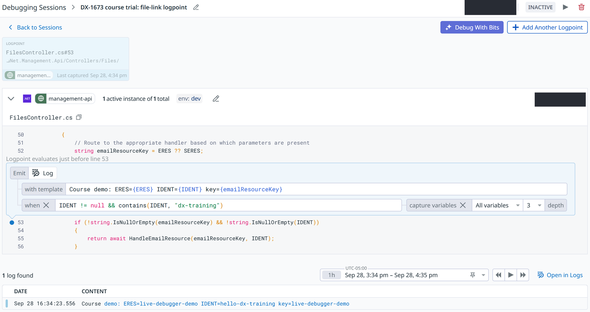

# Click Paths and Deep Links

> Every path and label here was walked in the live Datadog UI on **2026-09-25** (K6 and K7 on **2026-09-28**). Datadog changes its UI often, so if a label doesn't match, trust the screen and tell the course owner. Links contain no IDs, so they are safe to share; they open with Datadog's default time range.

Our Datadog site is **US5**: every link starts with `https://us5.datadoghq.com`.

## K1. Find a trace

**APM → Traces**

1. In the search bar, type `service:resident-api resource_name:"GET /api/user/dashboard" env:prod`.
2. Add `@duration:>5s` to see only slow requests.
3. **Search for: Spans | Traces** chooses between one row per span and one row per trace.
4. Next to it, **in** shows which spans you're searching. The last 15 minutes read **All Ingested Spans (Live Search)**; older windows read **Indexed Spans**, meaning only the spans retention kept.
5. The **Duration**, **Status**, **Env**, **Service** and **Resource** facets on the left filter without typing.
6. Click a row to open the trace.

Deep link: [slow dashboard requests](https://us5.datadoghq.com/apm/traces?query=service%3Aresident-api%20resource_name%3A%22GET%20%2Fapi%2Fuser%2Fdashboard%22%20env%3Aprod%20%40duration%3A%3E5s)

## K2. Read a trace

The trace opens in a side panel (the icon at its top right opens it full page).

- **Trace:** tabs pick the view: **Flame Graph**, **Waterfall**, **Span List** and **Map**.
  - Flame Graph: time runs left to right, children sit under their parent.
  - Waterfall: the same spans as a timeline list. Use the ⊞ button to **expand all**; it starts collapsed by service.
  - Span List: every span in a table. Group by **Service** and read the **Exec Time** column.
  - Map: the services the trace touched. Not covered here.
- **Color by: Service** and the legend on the right show % exec time per service.
- A trace that starts in the browser also shows the **resident-ui** browser span on top. The API is one of its children.

## K3. The span tabs

Click a span in the trace, then read the tabs under **Span:** at the bottom.

| Tab | Use it for |
| - | - |
| **Overview** | The span's attributes: env, version, status code, URL, user agent. |
| **Infrastructure** | The host the request ran on, its system info and its tags. |
| **Metrics** | .NET runtime metrics for the process around that moment: process CPU and memory usage, with a link to the .NET Runtime Metrics dashboard. |
| **Logs** | Logs correlated with this trace. |
| **Network**, **Processes** | Network and process data for the host. Rarely needed. |
| **SQL Queries** | Every database call in the request, slowest first. Parameter values are masked as `?`. |
| **Profiles** | What our code was doing during this span, from the profiler. The tab this course centers on. |

In **Profiles**: **Span & Children** vs **Process** picks the scope; the thread timeline shows when threads were busy; **Summary | Call Tree | Flame Graph** break it down; **Open in Profiling** jumps to the full profiler.

> Older docs call this tab **Code Hotspots**. It is now **Profiles**.

## K4. The Service page

**APM → Service**, then pick a service. Deep link: [resident-api, prod](https://us5.datadoghq.com/apm/entity/service%3Aresident-api?env=prod)

At the top: **operation**, **env** and **version** selectors. Check them first. The latency chart has its own **Latency for** *operation* selector. The wrong operation or env silently changes every number on the page.

Left nav, one line each:

| Tab | What it shows |
| - | - |
| Service Summary | Requests, errors, latency, incidents and SLOs at a glance. |
| Endpoints | Every resource with requests, total time, p95 and errors. Each ASP.NET endpoint appears once per operation. |
| Deployments | Versions seen, and how latency and errors moved between them. |
| Dependencies | What this service calls and what calls it. |
| Traces | Traces for this service, pre-filtered. |
| Errors | Error types and their traces. |
| Live Debugger | Log variable values from a line of running code without redeploying. See [K7](#k7-live-debugger-add-a-logpoint). |
| Infrastructure | The hosts running the service. |
| Runtime Metrics | .NET runtime health: GC, threads, exceptions. |
| Profiling | This service's profiles. |
| Frontend Usage | Which browser views call this service (preview). |
| Databases | The databases the service calls and their slow queries. |
| Logs | The service's logs. |
| Scorecards | How the service rates against Datadog's best-practice checks. |
| Security | Security findings for the service. |

Below them sit **Investigations** and **Dashboards**.

## K5. The Profiles explorer

**APM → Profiles → Explorer**. (The old `/apm/profiles` URL is a 404; the page lives at `/profiling/explorer`.)

1. Search `service:resident-api env:prod`.
2. **View** is **Flame Graph** (also Thread Timeline, Metrics, Profile List, Call Graph).
3. Pick the profile type from the cards: **CPU Time** is selected by default; click **Wall Time** for requests that wait on the database. Allocated Memory is not enabled for our services.
4. On the right, **For Endpoints** lists endpoints. Click `GET /api/user/dashboard` to show only that endpoint.
5. In **Filter flame graph** (left, above the graph), type `GetUserDashboardItems`, choose `method:"UserBP.GetUserDashboardItems()"`, then **focus_on**.
6. If the graph is empty, widen the time range. Low-traffic windows give thin profiles.

Deep link: [dashboard wall-time profile, filtered](https://us5.datadoghq.com/profiling/explorer?query=service%3Aresident-api%20env%3Aprod&profile_type=wall-time&endpoint=%7B%22incl%22%3A%5B%22GET%20%2Fapi%2Fuser%2Fdashboard%22%5D%7D&profiling-flame-graph__filter=focus_on%28method%3A%22UserBP.GetUserDashboardItems%28%29%22%29&viz=flame_graph)

> The filter needs the full method value, `UserBP.GetUserDashboardItems()`. A bare `GetUserDashboardItems` in the link finds nothing, with no error.

The filter operations: **highlight** (default, grays out other frames), **focus_on** (keep only stacks through the match), **show_from**, **ignore_from**, **hide**.

## K6. Exception Replay: see the values when it failed

**Errors → Error Tracking → Issues**

1. Search `env:prod service:identity-api` (any service works).
2. Open an issue. Under **Error sample**, the **Stack Trace** tab is open.
3. If Exception Replay captured this sample, a frame shows **Exception Replay snapshot (on exit)** under it: the method's arguments and local variables, such as `this`, `@exception` and the locals. Click **›** to open an object. A **Redaction** badge beside it shows the redaction mode, and sensitive values show as `[REDACTED]`.
4. If it didn't, the stack trace starts with **Exception Replay data was not captured** and a reason ([G13](gotchas.md#g13-exception-replay-skips-the-first-occurrence), [G14](gotchas.md#g14-some-exceptions-never-get-a-snapshot)). Try **Previous** and **Next** for other samples, or pick another issue.

To find issues that have snapshots, search Logs instead. Each snapshot is also stored as a log:

1. **Logs**, set the storage to **Flex** (snapshots are not in the default index).
2. Search `source:dd_debugger @debugger.product:er env:prod`. Each result is one snapshot, with its service. `@debugger.product:di` finds Live Debugger captures instead.
3. Open the matching issue in Error Tracking by service and exception type.

Deep link: [Exception Replay snapshots in prod](https://us5.datadoghq.com/logs?query=source%3Add_debugger%20%40debugger.product%3Aer%20env%3Aprod&storage=flex_tier)

> Snapshots from prod usually contain production data. Look at them on your own screen or in an internal call; don't paste them into a ticket, Slack or this repo. The one screenshot in the lesson was chosen because it holds none, and was reviewed before it was committed.

## K7. Live Debugger: add a logpoint

**APM → Debugger**, or **Live Debugger** in a Service page's left nav. Today this works only for `management-api` in `dev` ([G15](gotchas.md#g15-live-debugger-needs-a-setting-on-the-service-itself)).

1. **New Session** opens **Bits Live Debugger**, an AI preview. Skip it: scroll down to **Start debugging manually** and click **+ New Session**.
2. In **Add a logpoint to start debugging**, set **Choose service to instrument** to `management-api` and **Environment** to `dev`. Leave **Target specific instances** empty ([G19](gotchas.md#g19-leave-the-version-empty-while-testing)).
3. In **Search for a symbol or file**, type `FilesController` and pick the **CLASS** result. The source file opens. If the search says "Some results are missing", wait a few seconds, or use **Input method or file:line manually**.
4. Click the gutter to the left of line 53. The logpoint form opens under "Logpoint evaluates just before line 53":
   - **Emit Log with template:** `Course demo: ERES={ERES} IDENT={IDENT} resource={emailResourceKey}`
   - **when:** `IDENT != null && contains(IDENT, "dx-training")`
   - **capture variables:** **All variables**, **depth** 3
5. Click **Start Debug Session**. The session page shows **ACTIVE** with the minutes left (about 60). Wait about 30 seconds before testing.
6. Send a request that reaches the line. For this logpoint, from Git Bash:

   ```bash
   curl -s -o /dev/null -w "%{http_code}\n" "https://management-api.dev.ciranet.com/api/files/filelink?ERES=live-debugger-demo&IDENT=hello-dx-training"
   ```

   It returns `500`. That's expected: the fake value can't be decrypted, and the logpoint line runs before the failure.
7. The capture appears in the list under the code straight away. Click it to see the snapshot: the arguments, locals and fields. **Open in Logs** shows the same entry, but only after about three minutes ([G18](gotchas.md#g18-captures-appear-on-the-session-page-first)).
8. When you're done, stop the session from its header instead of waiting for it to run out.

**Add Another Logpoint** adds more lines to the same session. **Debug With Bits** hands the session to Datadog's AI. Put logpoints on plain statements, never on a line with `await` ([G17](gotchas.md#g17-a-logpoint-on-an-await-line-never-fires)).



*The screenshot is from the course trial, whose template said `key=`. The demo uses `resource=`.*
