# Session 1: Troubleshooting Slow Requests and Errors with Datadog and Claude

**Duration:** about 85 minutes, plus questions (one session)
**Format:** Presenter-led, with live demos in the browser (Datadog) and the terminal (Claude Code)
**Prerequisites:** [Setup guide](../../SETUP-GUIDE.md) completed, so Claude Code can reach Datadog

> 🖥️ **Presenting?** Open the [slide deck](../../slides/deck.html) and press `S` for speaker notes; follow the [run sheet](run-sheet.md). The deck is built from [`slides/deck-outline.md`](../../slides/deck-outline.md).

This page is the lesson in text form. Read it after the session, or instead of it. It groups the Claude prompts in section 6; in the session, each part ends with the prompts for that part.

---

## 1. The words first

A **service** is one application reporting to Datadog (`resident-api`). A **span** is one timed piece of work, done once, such as a request or a SQL call. A **resource** is the label on a span that says what kind of work it was: the endpoint for a request (`GET /api/user/dashboard`) or the query for a SQL call. Every request to the dashboard is a new span, and they all share that one resource. A **trace** is every span for one request, parent to child, across services: here the browser (`resident-ui`), the API and the database. The [glossary](../../resources/glossary.md) has the rest.

---

## 2. APM orientation

A guided tour, not a deep dive. The goal is to know what each screen is for. Exact click paths are in [Click paths](../../resources/click-paths.md).

### 2.1 Finding traces

**APM → Traces** searches spans. Filter by service, resource, env and duration:

```text
service:resident-api resource_name:"GET /api/user/dashboard" env:prod @duration:>8s
```

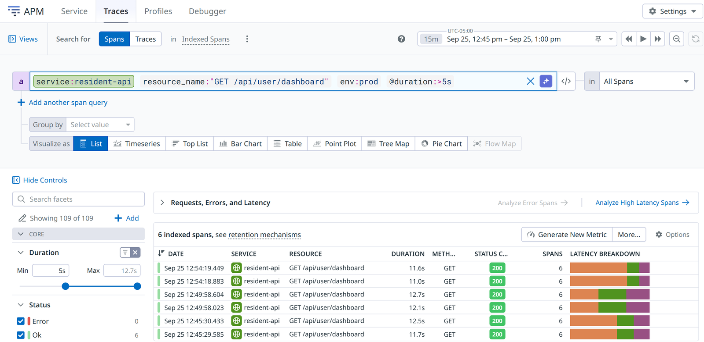

- **Spans | Traces** switches between one row per span and one row per trace.
- **Live Search** (the **LIVE · 15 Minutes** time range) searches **all ingested spans**, for the last 15 minutes only. Every other time range is **Historical Search**: **indexed spans** only, a sample kept by retention filters. The label left of the time picker says which one you're in. That is why a span count is never a request count ([G8](../../resources/gotchas.md#g8-span-counts-are-sampled)).

### 2.2 Three views of one trace

Click a row and the trace opens. The **Trace:** tabs show the same spans three ways (plus a service **Map**):

| View | Read it as |
| - | - |
| **Flame Graph** | Time runs left to right; each span sits under its parent. Good for seeing shape and gaps. |
| **Waterfall** | The same spans as a timeline list. Expand all to see every child. |
| **Span List** | Every span in a table. Group by service and read **Exec Time**: time spent in that service's own code. |

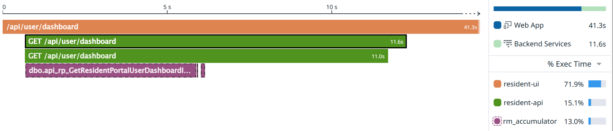

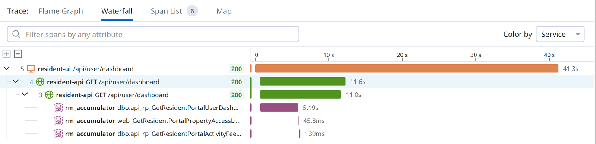

### 2.3 The gap

Look at the dashboard trace above. The stored procedure `api_rp_GetResidentPortalUserDashboardInfo` runs for about 5 seconds. Two small queries follow. Then **nothing** until the request ends at 11 seconds.

Time inside a span that no child span covers is time in **our own code**. Tracing only records calls out (SQL, HTTP, cache), so it can't say what the code was doing. The Span List says the same thing in numbers: `resident-api` exec time 6.24 s.

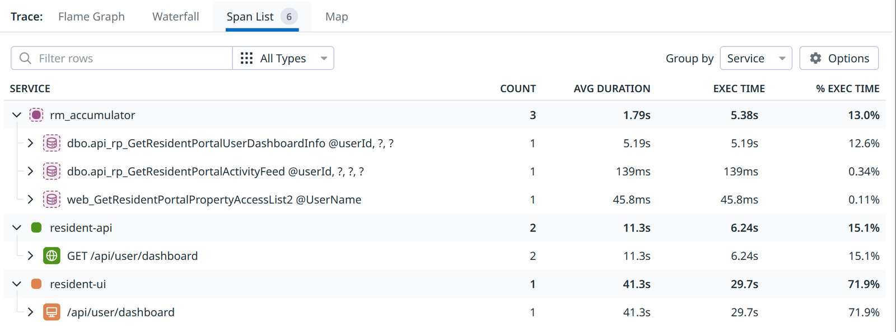

That gap is where profiling comes in.

### 2.4 The span tabs

Click a span and read the tabs under **Span:**. One line each:

- **Overview**: attributes such as env, version, status code and URL.
- **Infrastructure**: the host the request ran on, and its tags.
- **Metrics**: .NET runtime metrics for the process at that moment (CPU, memory).
- **Logs**, **Network**, **Processes**: logs for this trace, and host network and process data.
- **SQL Queries**: every database call in the request, with values masked.
- **Profiles**: which of our methods ran during this span. The rest of the session builds on this tab.

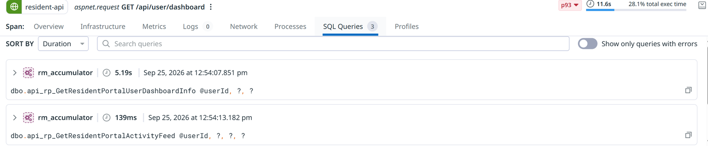

### 2.5 The Service page

**APM → Service → resident-api** is the dashboard for one service. The left nav has Service Summary, Endpoints, Deployments, Dependencies, Traces, Errors, Live Debugger, Infrastructure, Runtime Metrics, Profiling, Frontend Usage, Databases, Logs, Scorecards and Security. [Click paths](../../resources/click-paths.md#k4-the-service-page) has one line on each.

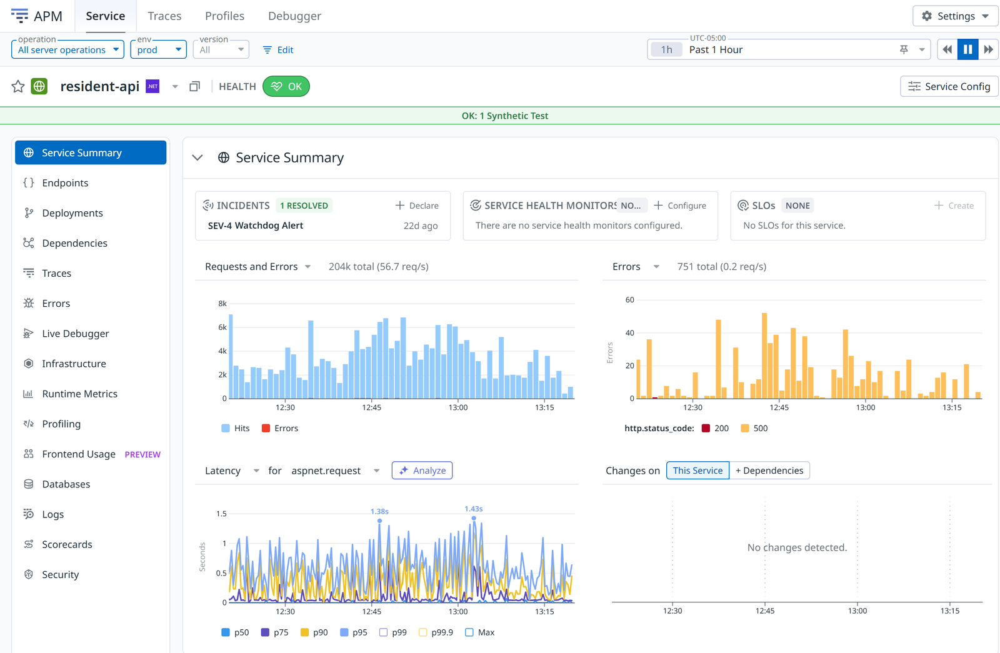

Before trusting a number here, check the **operation**, **env** and **version** selectors at the top. Each ASP.NET endpoint reports under two operations, and the wrong one silently changes every number ([G10](../../resources/gotchas.md#g10-check-the-operation-and-env-selectors)).

Live Debugger has its own tab here too. It and Exception Replay are in section 5 below.

---

## 3. Profiling

### 3.1 Tracing vs profiling

**Tracing** tells you *that* a request was slow and which dependencies it called. **Profiling** tells you *what our code was doing*. The continuous profiler samples every thread's stack many times a second, all day, with a few percent of CPU overhead. It runs on every CiraNet .NET Framework API in dev, qa and prod since 2026-09-22 (DX-1605).

### 3.2 Reading a flame graph

- **Width is time.** A wider frame took longer. Left-to-right order means nothing.
- **Read top-down.** Callers are above, the methods they called are below.
- **Follow our namespaces.** Skip framework frames and follow `CiraNet...` frames down to the widest one of ours.

### 3.3 Profile types: pick Wall Time

Our .NET services collect CPU, Wall Time, Exceptions, Lock Contention and GC profiles. Two matter most:

- **CPU Time** counts only time a thread was running on a CPU. It's the default.
- **Wall Time** counts elapsed time, running or waiting.

A request that waits on the database hardly shows up in CPU Time, so start with **Wall Time** for slow requests ([G1](../../resources/gotchas.md#g1-the-profiles-page-opens-on-cpu-time)). Wall Time also counts sleeping threads, so filter it to an endpoint and to our code ([G2](../../resources/gotchas.md#g2-wall-time-includes-idle-threads)).

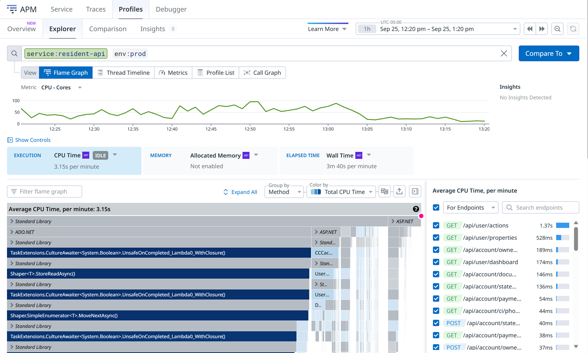

### 3.4 From one slow trace to its profile

On the trace, click the `resident-api` span, then the **Profiles** tab. The thread timeline shows the threads idle while SQL runs, then busy from about 5 s to the end. In the flame graph below it, `UserBP.GetUserDashboardItems()` has **5.05 s of CPU time**. That is the gap.

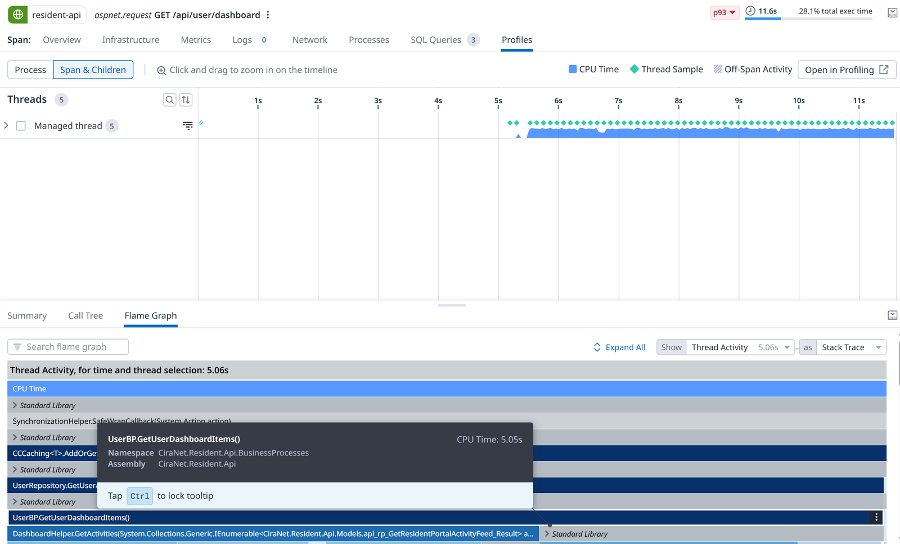

Notice where it sits: under `UserRepository.GetUserActivityFeed` and a caching call. That is async code nesting under the awaited call, not a slow repository ([G4](../../resources/gotchas.md#g4-async-code-nests-under-the-awaited-call)). Frames show line 0 until DX-1570 lands ([G5](../../resources/gotchas.md#g5-frames-show-line-0)).

---

## 4. Worked examples

### 4.1 The resident portal dashboard (resident-api)

`GET /api/user/dashboard` is usually fast (about 200 ms at the median), but a slow tail takes 10 seconds or more.

1. **The trace** shows two parts. The stored procedure `api_rp_GetResidentPortalUserDashboardInfo` takes several seconds (5 to 10 s in the traces checked). Then **4 to 6 seconds** pass with no spans under the API span.
2. **The profile** (APM → Profiles, `service:resident-api env:prod`, **Wall Time**, endpoint `GET /api/user/dashboard`, **Filter flame graph** `focus_on(method:"UserBP.GetUserDashboardItems()")`) shows what fills the gap:
   - `UserBP.GetUserDashboardItems` cross joins every activity feed item with every property.
   - For each pair it calls `EnumExtensions.GetEnumFromDescription`, which uses reflection (`Attribute.GetCustomAttribute`) on every call.
   - `DashboardHelper.GetActivities` repeats the same lookup per item.
   - `GetEnumFromDescription` is about a third of the endpoint's wall time, and nearly all of that is reflection.

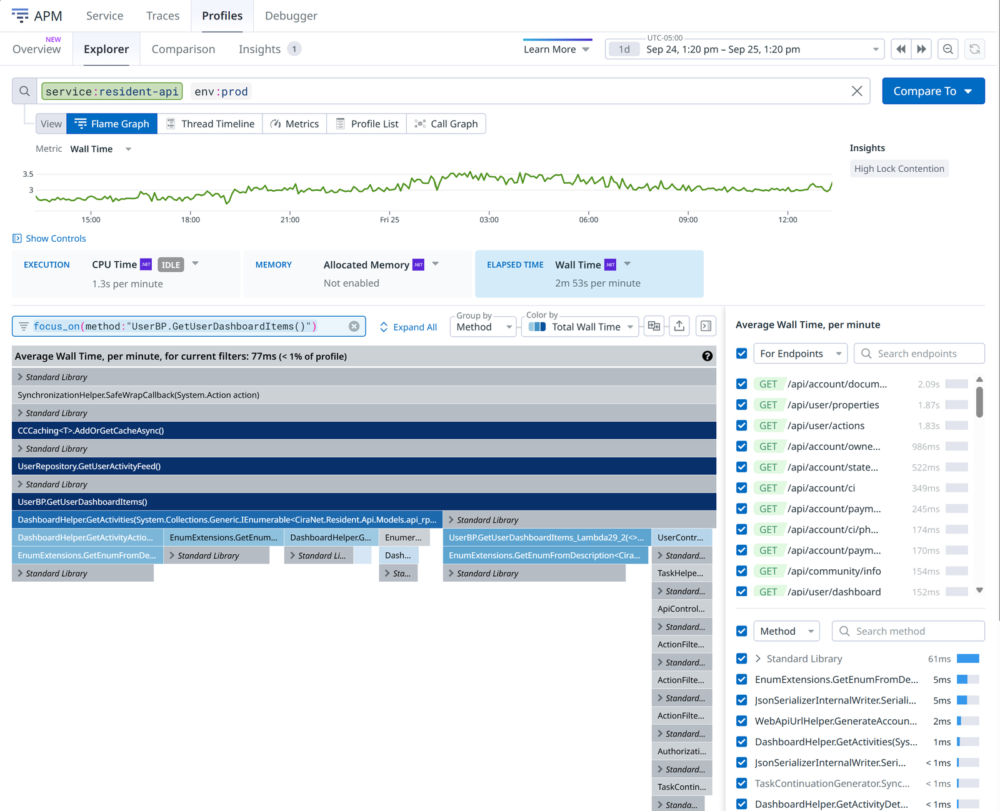

Across the whole service this method is under 1% of the profile. Inside one slow request it's 5 seconds. Aggregate views hide per-request pain, which is why the trace-to-profile path matters.

### 4.2 When the profiler says "it's the database" (management-api)

`GET /api/wf/search` on `management-api` has a p50 of about 1.2 s and a long tail (p99 well over a minute). Its traces show the stored procedure `api_mp_SearchWorkflows` taking most of each slow request. Its wall-time profile shows threads waiting in Entity Framework and `SqlDataReader.ReadAsync` for rows to arrive. Only a sliver of the time is our own code (`WorkflowBP.GetSearchInvoice`).

This is the contrast to 4.1. A profile with little of our code in it is still an answer: speeding up the C# won't help; look at the query and how much data it returns.

### 4.3 "Is this real?" (management-api Watchdog story)

On 2026-09-22 Watchdog raised latency stories on `management-api` during the profiler rollout. The unsampled p95 went from about 0.7 s to **2.27 s** for one 10-minute window (18:40–18:50 UTC), then straight back to 0.68 s. The median never moved. The same window the day before was 0.68 s.

One window, all hosts, median flat, straight back to baseline: that is cold-start warm-up after IIS recycled the app pools (JIT compilation, EF model build, cache refill). It isn't a regression. Datadog had no event for the recycle, so Claude can't know about it unless you tell it. [Checking Claude's work](../../resources/checking-claudes-work.md) walks through this one.

---

## 5. Finding the cause of an error: Exception Replay and Live Debugger

Profiling shows where the *time* goes. These two features show the *values* in running code. Both are fairly new in Datadog and have limits, listed below. Section 6 shows Claude using both.

### 5.1 Exception Replay

When an exception happens, **Error Tracking** groups it into an issue and shows a stack trace. **Exception Replay** adds a **snapshot**: the arguments and local variables of each frame, as they were when the exception was thrown.

- It's already on for our services through Datadog's remote settings, and prod produces snapshots every day. There is nothing to install.
- It starts on the **second** time an exception happens on the same server, then takes at most one snapshot per exception type, per server, per hour ([G13](../../resources/gotchas.md#g13-exception-replay-skips-the-first-occurrence)).
- Values with sensitive names are shown as `[REDACTED]`. A **Redaction** badge shows the mode.
- Some exceptions never get one: the issue says the data "could not be captured due to an internal error" ([G14](../../resources/gotchas.md#g14-some-exceptions-never-get-a-snapshot)).

**Where:** **Errors → Error Tracking**, open an issue, **Error sample → Stack Trace**. A frame with a snapshot shows **Exception Replay snapshot (on exit)** under it. To find issues that have snapshots, search Logs (Flex storage) for `source:dd_debugger @debugger.product:er`. Full steps: [K6](../../resources/click-paths.md#k6-exception-replay-see-the-values-when-it-failed).

Here is a real one from identity-api in production. It was picked because it holds no customer data: a validation error whose values are type names and the validation message.

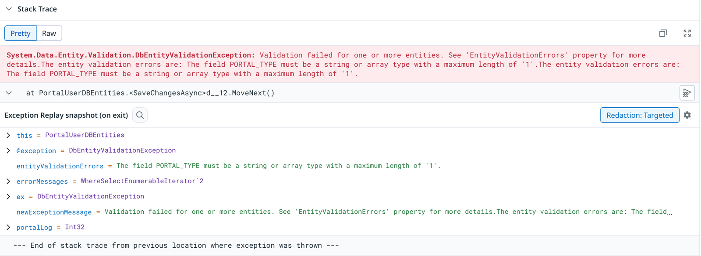

Most prod snapshots do contain production data. Look at them in Datadog; don't paste them into a ticket, Slack or a repo.

### 5.2 Live Debugger

**Live Debugger** logs values from a line of code you choose, in a running service, without a code change, deploy or restart. You start a **debug session** and add a **logpoint**: a file and line, a message template with `{variable}` placeholders, and optionally a **condition** so only the requests you care about are logged. The session stops by itself after about an hour.

The course demo puts a logpoint just before line 53 of `FilesController.cs` in `management-api` (dev), with the condition `IDENT != null && contains(IDENT, "dx-training")`, then sends one request with `curl`. The capture shows on the session page within seconds:

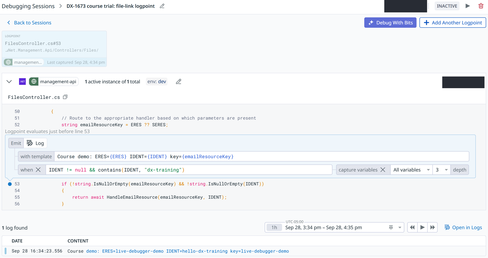

What to know before you try it:

- It only works where the service has `DD_DYNAMIC_INSTRUMENTATION_ENABLED=true` in its own configuration. Today that's `management-api` in dev. Turning it on from Datadog's side wasn't enough, and DX-1573 tracks adding the setting everywhere ([G15](../../resources/gotchas.md#g15-live-debugger-needs-a-setting-on-the-service-itself)).
- Most prod services are set to **Strict** redaction, which blocks logpoints ([G16](../../resources/gotchas.md#g16-strict-redaction-blocks-logpoints-in-prod)).
- Lines with `await` can't be instrumented; use plain statements ([G17](../../resources/gotchas.md#g17-a-logpoint-on-an-await-line-never-fires)).
- Watch the session page. Captures reach Logs search about three minutes later ([G18](../../resources/gotchas.md#g18-captures-appear-on-the-session-page-first)).
- Leave **Target specific instances** empty, or the next deploy silently orphans the logpoint ([G19](../../resources/gotchas.md#g19-leave-the-version-empty-while-testing)).

Full steps: [K7](../../resources/click-paths.md#k7-live-debugger-add-a-logpoint).

### 5.3 Which tool for which question

| Question | Tool |
| - | - |
| Why is this request slow? | The trace, then the profile (sections 2 and 3) |
| Why did it throw? | Exception Replay, on the Error Tracking issue |
| What is this value at this line, right now? | Live Debugger (dev only, for now) |

---

## 6. Investigating with Claude and the Datadog MCP

Claude Code with the Datadog MCP server runs the queries for you: it searches spans, reads metrics, pulls profiles and compares time windows, and it reads Error Tracking issues and Exception Replay snapshots. It can even add a Live Debugger logpoint. A basic Datadog user can ask an advanced question in plain English. The [demo prompts](../../resources/demo-prompts.md) are tested and copy-pasteable.

For a slow request:

1. **Find** the slow endpoints (P2).
2. **Split** one slow request into SQL time and our own code (P3).
3. **Profile** it to name the method (P4).
4. **Contrast** with a database-bound case (P5).

For an error:

1. **Explain** it from its Exception Replay snapshot (P9). Claude reads the captured values, says what they show, and says what they can't.
2. **Capture** the missing value with a logpoint in dev (P10), send a request, then read the capture and disable the logpoint (P10b). This is the only prompt that changes anything, so keep it to dev, always with a condition.

Either way:

1. **Ask "is it real?"** against a baseline (P6).
2. **Check** the queries and links (P7).
3. **Draft** the ticket (P8).

---

## 7. Checking Claude's work

Claude is only as good as the queries it runs, and some Datadog queries return misleading answers without any error. The habit, in full in [Checking Claude's work](../../resources/checking-claudes-work.md):

1. Ask which query it ran and for a Datadog link, then check the results yourself.
2. Be careful with "0 results" and with rates calculated from span counts.
3. Give it the context Datadog can't see (deploys, config changes, recycles, what users reported).

---

## 8. After the session

- Keep the [cheat sheet](../../resources/cheat-sheet.md).
- Within two weeks, run one investigation on a service you own and post one finding in the course Slack thread.
